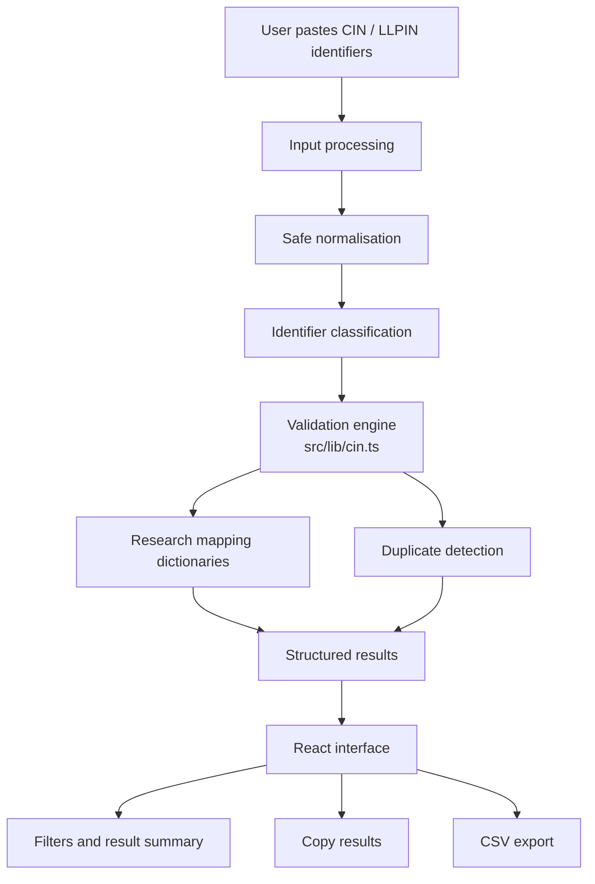

 <div align="center">

# FileSure — CIN & LLPIN Checker

**A browser-based identifier checker that turns Indian CINs and LLPINs into clear, structured and understandable results.**

Bulk validation · CIN segment analysis · LLPIN format checking · Duplicate detection · CSV export · Privacy-first processing.

<br>

<a href="https://filesure-cin-llpin-checker.vercel.app"></a>

<br>

<a href="https://github.com/aayushtiwari307/filesure-cin-llpin-checker"></a>


<br>

<a href="#-live-demo"></a>
<a href="#-features"></a>
<a href="#-how-it-works"></a>
<a href="#-architecture"></a>
<a href="#-validation-rules"></a>
<a href="#-quick-start"></a>
<a href="#-testing-and-verification"></a>

<br>

<sub>Client-side format checker. No account, backend, database or API key required. This is not a live MCA registry verification service.</sub>

</div>

---

## 🌐 Live demo

> [!TIP]
> **No installation needed.** Open the deployed application and paste one or more CIN or LLPIN identifiers to explore the checker.

| | |
|---|---|
| 🌐 **Live application** | [filesure-cin-llpin-checker.vercel.app](https://filesure-cin-llpin-checker.vercel.app) |
| 💻 **Source code** | [GitHub Repository](https://github.com/aayushtiwari307/filesure-cin-llpin-checker) |
| ☁️ **Hosting** | Vercel |
| 🔓 **Access** | Public |
| 🔑 **Login** | Not required |

### Try it in about 30 seconds

1. Open the [live application](https://filesure-cin-llpin-checker.vercel.app).
2. Paste multiple identifiers into the input area, one per line.
3. Review the results and summary counts.
4. Select the **Invalid** or **Review** filter to inspect specific entries.
5. Try copying the results or downloading them as a CSV file.

Use synthetic examples for testing. A result marked valid means that its structure passes the application's rules; it does not confirm that the company exists.

---

## 🎯 The problem

CINs and LLPINs are structured identifiers used to identify companies and Limited Liability Partnerships in India. However, manually inspecting them can be confusing, especially when dealing with multiple records.

A basic pattern checker can tell users whether a string matches a format, but it often fails to explain what the individual segments represent or why an entry needs attention.

FileSure was built to make this process easier.

## ✨ What FileSure does

FileSure accepts multiple CIN and LLPIN identifiers and turns them into structured validation results.

Instead of returning only a valid or invalid label, it explains the identifier's structure, extracts information where supported, highlights problematic segments, and distinguishes actual format errors from mapping limitations.

---

## 🚀 Features

| Feature | What it does |
|---|---|
| 🏢 **CIN validation** | Checks the 21-character CIN structure and its individual segments. |
| 📄 **LLPIN validation** | Recognises LLPINs consisting of three letters and four digits, with an optional display hyphen. |
| 📥 **Bulk input** | Processes multiple identifiers in one submission, including tab-separated spreadsheet cells. |
| 🧩 **Segment breakdown** | Displays the individual CIN components and identifies problematic segments. |
| 🗺️ **State mapping** | Maps researched state and territory codes, while flagging uncertain or unmapped values for review. |
| 📅 **Year extraction** | Extracts the incorporation-year segment from CINs. |
| 📋 **Company classification** | Explains recognised listing and company-type codes where supported by the research. |
| ⚠️ **Explainable validation** | Provides specific reasons for invalid or review-needed results. |
| ♻️ **Duplicate detection** | Identifies repeated identifiers after safe normalisation. |
| 🔎 **Result filters** | Filter between All, Invalid and Review-needed entries. |
| 📋 **Copy results** | Copy the currently visible result set. |
| 📊 **CSV export** | Export filtered results with proper CSV escaping and spreadsheet-friendly handling. |
| 📱 **Responsive interface** | Supports desktop and mobile screen sizes. |
| ⚡ **Large input handling** | Supports bulk processing with a safety limit of 5,000 non-empty entries. |

---

## 🧭 How it works

The application follows a simple processing pipeline:

1. **Input:** Accepts one or more identifiers from the user.
2. **Normalisation:** Handles safe formatting differences such as surrounding whitespace, letter case and supported LLPIN hyphen formatting.
3. **Classification:** Determines whether an entry is a CIN candidate or an LLPIN candidate.
4. **Validation:** Checks the expected structure and individual character positions.
5. **Information extraction:** Retrieves available metadata from researched mapping dictionaries.
6. **Duplicate detection:** Identifies repeated identifiers without silently changing malformed values.
7. **Result generation:** Assigns a status and provides an explanation.
8. **Export:** Allows users to filter, copy and download their results.

### Result categories

| Status | Meaning |
|---|---|
| 🟢 **Valid** | The identifier follows the recognised structural rules and has no review-level mapping warning. |
| 🟡 **Needs Review** | The structure may be correct, but a mapping, historical code or duplicate requires attention. |
| 🔴 **Invalid** | The identifier does not satisfy the expected structural rules. |

A result can be structurally valid without being verified against an official company registry.

---

## 🏗 Architecture

The project deliberately uses a lightweight client-side architecture. There is no separate API server or database.



### Why this architecture?

- **No backend dependency:** The application can run as a static website.
- **Separation of concerns:** Validation logic is kept independent of the React interface.
- **Testability:** The core parser can be tested without rendering the UI.
- **Simple deployment:** Vite generates static production assets that can be hosted on Vercel.
- **Privacy by design:** Pasted identifiers are processed in the browser rather than submitted to an application backend.

---

## 🔍 Validation rules

### 1. Corporate Identification Number (CIN)

A standard CIN has 21 characters, divided into six components:

| Position | Length | Meaning |
|---|---:|---|
| 1 | 1 | Listing status (`L` or `U`) |
| 2–6 | 5 | Industry / activity code |
| 7–8 | 2 | State / territory code |
| 9–12 | 4 | Incorporation year |
| 13–15 | 3 | Company classification code |
| 16–21 | 6 | ROC registration number |

The application checks these segments individually and extracts the information supported by its mapping data.

Unknown or historically ambiguous codes are handled conservatively. A code that is correctly shaped but not confidently mapped is not automatically treated as proof of an invalid CIN.

### 2. Limited Liability Partnership Identification Number (LLPIN)

The checker recognises the LLPIN structure:

```text
AAA1234
AAA-1234
```

The display hyphen is optional in pasted input. When omitted, it is added for display and the normalisation is disclosed.

The checker does not claim that LLPIN segments encode the same state, year, listing or company-type information available in a CIN.

### 3. Validation is not registry verification

> [!IMPORTANT]
> **FileSure performs format validation and information extraction. It does not verify the existence or current legal status of a company or LLP.**

The application does not connect to the Ministry of Corporate Affairs (MCA) registry or perform live company-master-data lookups.

A structurally valid identifier does not prove that the entity exists, is active, is authentic, or has a particular legal status.

For official verification, users should consult the [Ministry of Corporate Affairs](https://www.mca.gov.in/).

---

## 🧪 Testing and verification

The project includes automated tests for both the validation engine and interface behaviour.

| Check | Result |
|---|---|
| CIN and LLPIN validation tests | ✅ Passed |
| React UI interaction tests | ✅ Passed |
| TypeScript type checking | ✅ Passed |
| Production build | ✅ Passed |
| Dependency security audit | ✅ 0 vulnerabilities at the final pre-submission check |

**Automated test snapshot:** 66 tests passed (55 validation and 11 UI tests) in the verified build on 25 November 2026.

### Edge cases considered

- Invalid identifier lengths and character positions.
- Lowercase and uppercase inputs.
- LLPINs with and without hyphens.
- Duplicate CIN and LLPIN entries.
- Historical and unmapped state codes.
- Multiple identifiers on a single line.
- Tab-separated spreadsheet input.
- Blank rows and formatting characters.
- CSV special characters, formula injection and leading zeroes.
- Unicode characters and malformed punctuation.
- Large bulk inputs.

### Manual verification

The interface was also checked using browser-based scenarios, including filtering, copying, CSV downloads, duplicate handling and a 500-entry bulk-input scenario.

An independent review was used to identify additional edge cases before the final build.

---

## 🧰 Tech stack

| Layer | Technology |
|---|---|
| UI | React 19 |
| Language | TypeScript |
| Build tool | Vite 7 |
| Styling | CSS |
| Unit testing | Vitest |
| UI testing | React Testing Library |
| Test environment | jsdom |
| Deployment | Vercel |
| Source control | Git and GitHub |

---

## 🚀 Quick start

### Requirements

- Node.js 22.12+
- npm 10.9.9+ (npm 11.21.3 is the configured package manager version)

### Clone the repository

```bash
git clone https://github.com/aayushtiwari307/filesure-cin-llpin-checker.git
cd filesure-cin-llpin-checker
```

### Install dependencies

```bash
npm install
```

### Start the development server

```bash
npm run dev
```

Open the local URL printed in the terminal, usually:

```text
http://localhost:5173
```

No backend, database, API key, or environment configuration is required.

### Production build

```bash
npm run build
```

The generated static application is available in `dist/`.

---

## ✅ Quality commands

```bash
npm test
```

Runs the automated test suite.

```bash
npm run typecheck
```

Checks TypeScript project references.

```bash
npm run build
```

Creates the production build.

```bash
npm run preview
```

Serves the production build locally for review.

---

## 📁 Project structure

```text
filesure-cin-llpin-checker/
│
├── public/
│   └── favicon.svg
│
├── src/
│   ├── lib/
│   │   └── cin.ts
│   ├── data/
│   │   ├── researchMappings.ts
│   │   └── realFixtures.ts
│   ├── test/
│   │   └── setup.ts
│   ├── main.tsx
│   └── styles.css
│
├── docs/
│   ├── RESEARCH.md
│   ├── TEST-PLAN.md
│   ├── INDEPENDENT-REVIEW.md
│   ├── AI-VERIFICATION-LOG.md
│   ├── SECURITY-UPDATE.md
│   └── UI-REFRESH-NOTES.md
│
├── package.json
├── package-lock.json
├── SPEC.md
├── tsconfig.json
└── vite.config.ts
```

---

## 🔐 Privacy and security

- All identifier processing is performed in the browser.
- No user account or login is needed.
- There is no application backend or database.
- Pasted identifiers are not sent to an application API.
- CSV generation includes escaping for spreadsheet safety and protections against formula injection.
- No API credentials or environment secrets are required.

Users should still avoid entering confidential information on public or shared devices.

---

## 🤖 AI-assisted development and engineering decisions

AI tools were used as development assistants during the project. Their output was reviewed rather than accepted without verification.

An independent review helped identify issues that required correction, including a missing `UR` Uttarakhand state-code mapping, UI readability improvements and CSV compatibility edge cases.

The state mapping was updated with supporting research and regression tests. Other corrections were also checked against the implementation and test suite.

The repository includes:

- [`docs/RESEARCH.md`](docs/RESEARCH.md) — source material and CIN/LLPIN format research.
- [`docs/INDEPENDENT-REVIEW.md`](docs/INDEPENDENT-REVIEW.md) — independent review findings and corrections.
- [`docs/AI-VERIFICATION-LOG.md`](docs/AI-VERIFICATION-LOG.md) — implementation issues caught and corrected during AI-assisted development.
- [`docs/TEST-PLAN.md`](docs/TEST-PLAN.md) — test coverage and verification approach.

The goal was not just to generate an interface, but to review the validation rules, test edge cases, and make the resulting application understandable and reliable within its stated scope.

---

## ⚠️ Known limitations

- No live MCA registry lookup or company-status verification.
- State and company-type interpretation depends on the available researched mappings.
- Some historical and administrative code differences require a review warning.
- LLPIN metadata beyond its recognised format is not decoded.
- The tool is a format explainer, not a legal or compliance certification service.
- The current implementation is a browser-only application and does not store user-submitted records on a server.

---

## 🗺 Future improvements

- Integration with an authorised MCA data source for registry-level verification.
- Additional sourced identifier mappings and historical-code coverage.
- More import options for spreadsheet workflows.
- Expanded accessibility and cross-browser testing.

---

<div align="center">

**Built by [Aayush Tiwari](https://github.com/aayushtiwari307)**

[Live Application](https://filesure-cin-llpin-checker.vercel.app) · [GitHub Repository](https://github.com/aayushtiwari307/filesure-cin-llpin-checker)

<sub>Built with React, TypeScript and a focus on explainable validation.</sub>

</div>
